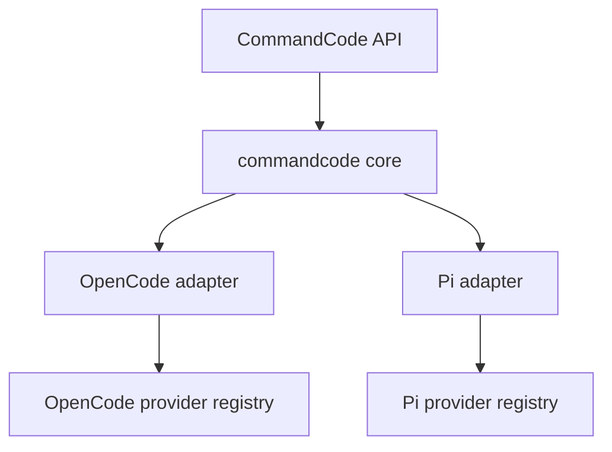

# CommandCode provider integration

## Goal

One shared CommandCode catalog and transport core, with native adapters for OpenCode and Pi.

The integration uses CommandCode's Provider API. It does not emulate the CommandCode CLI, its `/alpha/generate` transport, its tool aliases, or its harness features.

## Source of truth

CommandCode exposes two model views:

- `GET /provider/v1/models` returns `supported_endpoints` per model. Authenticated.
- `GET /provider/v1/models?view=client` returns the client catalog: `schemaVersion`, `catalogVersion`, `refreshAfterSeconds`, and per model `reasoningEfforts`, `pricing`, `inputModalities`, `aliases`, `minimumPlan`, `behaviorProfile`, `zdr`, and `hidden`.

The client catalog is the source for capabilities, efforts, and pricing. The public list is the source for endpoint routing. Merge both by model ID.

`models.dev` and OpenRouter are fallbacks only. Their CommandCode entries are incomplete or disagree with the live client catalog.

Set a stable `User-Agent` on every request. Cloudflare returns `403 error code: 1010` for Python's default user agent; a normal curl or host user agent works.

## Architecture



The core has no host dependencies. It returns normalized model records. Each adapter maps those records to its host API and leaves streaming, tools, usage, cancellation, and retries to the host.

## Shared core

### Catalog

`loadCatalog()`:

1. Fetch both model endpoints in parallel.
2. Validate the client catalog `schemaVersion`.
3. Merge by model ID. Client fields win for name, context, efforts, modalities, pricing, aliases, plan, and visibility. Public fields win for `supported_endpoints`.
4. Resolve a protocol for every model.
5. Cache `{ catalogVersion, fetchedAt, refreshAfterSeconds, models }`.
6. Refresh when `refreshAfterSeconds` elapses. Use `If-None-Match` with the stored `catalogVersion`.

If the client catalog fails, use the cached catalog. If no cache exists, use the public list with no effort menu. Never invent effort levels.

### Protocol selection

A model has one of three protocols:

| Protocol | CommandCode route | Host package |
|---|---|---|
| `anthropic-messages` | `/messages` | OpenCode `anthropic-compatible`; Pi `anthropic-messages` |
| `openai-chat` | `/chat/completions` | OpenCode `openai-compatible`; Pi `openai-completions` |
| `openai-responses` | `/responses` | OpenCode `openai-compatible/responses`; Pi `openai-responses` |

Selection is chat-first:

1. Claude by group or ID: Anthropic Messages.
2. `/chat/completions` present: Chat.
3. `/messages` only: Anthropic Messages.
4. `/responses` present: Responses.
5. Unknown or missing endpoints: Chat, marked unverified.

This routes all 85 non-Claude public models to Chat: 72 list both routes and prefer Chat, 13 list only Chat. All 12 Claude models route to Messages. No visible model routes to Responses today.

Responses remains the automatic fallback for a future model that lists only `/responses`, or for a model whose Chat route is verified broken while Responses works. The route comes from `supported_endpoints`; it is not a hand-maintained per-model map. A `403` is plan gating, not a routing failure.

#### Verified endpoint behavior

Probe of the 72 public models that list `/responses`:

- 47 returned `200`.
- 17 returned `403` because of plan access.
- 8 returned upstream errors on both routes: provider routing, model not found, or a stealth-model failure.
- `Qwen/Qwen3.6-Plus` returned `400` on `/responses` but `200` on `/chat/completions`; chat-first routing avoids that fallback.

Every model that lists `/responses` also lists `/chat/completions`, so the chat-first policy never selects Responses for the current visible catalog. Responses support stays in the code for future models; it is not the default.

Both routes support streaming and tool calls. The routes do not share the same effort enum:

| Route | `reasoning_effort` values |
|---|---|
| `/chat/completions` | `off`, `low`, `medium`, `high`, `xhigh`, `max` |
| `/responses` | `none`, `minimal`, `low`, `medium`, `high`, `xhigh`, `max` |
| `/messages` | Anthropic `thinking` and `effort` settings |

The catalog uses `off`. Map it to `none` on `/responses`, `off` on `/chat/completions`, and the disabled-thinking setting on `/messages`.

### Thinking levels

The catalog `reasoningEfforts` array is the only source. No runtime effort probes.

Pi has seven levels; CommandCode has no `minimal`.

| Pi level | Mapping |
|---|---|
| `off` | `off` on chat, `none` on responses, disabled thinking on Anthropic; `null` when absent from the catalog |
| `minimal` | `low` when `low` exists, otherwise `null` |
| `low`, `medium`, `high`, `xhigh`, `max` | same value when present, otherwise `null` |

A model with an empty or null `reasoningEfforts` is registered with `reasoning: false` and no variant menu.

### Pricing

Map `pricing.inputCost`, `outputCost`, `cacheReadCost`, and `cacheWriteCost` to host cost fields. Map `contextTiers` to Pi `cost.tiers` and OpenCode cost tiers. Missing pricing becomes zero cost, not a fabricated price.

### Auth

Single key everywhere:

1. `COMMANDCODE_API_KEY`.
2. `~/.pi/agent/commandcode/auth.json` (`apiKey` or first `apiKeys` entry).
3. `~/.commandcode/auth.json` (`apiKey`).

No key pool, no cooldown state, no per-request rotation. A failed key is a configuration error, not a failover event.

## OpenCode adapter

Use `Plugin.define` and `ctx.provider.transform`.

### Provider

One provider ID, `commandcode`:

```ts
{
  id: "commandcode",
  name: "Command Code",
  activation: "enabled",
  package: "@opencode/ai/providers/openai-compatible",
  settings: {
    baseURL: "https://api.commandcode.ai/provider/v1",
    apiKey,
  },
}
```

Each model sets its own `package`:

- `anthropic-messages` models use `@opencode/ai/providers/anthropic-compatible`.
- `openai-responses` models use `@opencode/ai/providers/openai-compatible/responses`.
- `openai-chat` models use `@opencode/ai/providers/openai-compatible`.

The responses package ID is verified against OpenCode 2.2.6.

### Models

Map each catalog record to `Model.Info`:

- `name` from `display.label`.
- `display.group` is for metadata only; `family` is omitted because the client group is a vendor, not a model family.
- `capabilities.tools = true`.
- `capabilities.input` from `inputModalities`.
- `capabilities.output = ["text"]`.
- `limit.context` from `context_length`.
- `limit.output` from `maxOutputTokens`, else the provider default.
- `cost` from `pricing` and its tiers.
- `variants` from `reasoningEfforts`.
- `enabled = true`, `status = "active"`.
- `hidden` models excluded by default.

Variants:

```ts
// Anthropic
{ id: effort, settings: {
  thinking: { type: "adaptive", display: "summarized" },
  effort,
}}

// off
{ id: "none", settings: { thinking: { type: "disabled" } } }

// OpenAI chat
{ id: effort === "off" ? "none" : effort, settings: { reasoningEffort: effort } }

// OpenAI responses
{ id: effort === "off" ? "none" : effort, settings: {
  reasoningEffort: effort === "off" ? "none" : effort,
}}
```

Map catalog `off` to variant ID `none` and to the protocol-specific value above. Chat sends `off`; Responses sends `none`.

### Refresh and cache

Use `ctx.storage` for the catalog snapshot. Register models before any blocking network work when a snapshot exists; refresh in the background and call `ctx.provider.reload()` when the catalog version changes.

Remove the CommandCode entry from the generic `provider-models` plugin and remove the hardcoded `providers.commandcode.models` block from `opencode.json`. The CommandCode plugin owns the provider inventory.

## Pi adapter

Use the native `createProvider` API from `@earendil-works/pi-ai`. Do not use `streamSimple`, `/alpha/generate`, or CLI protocol conversion.

```ts
import {
  anthropicMessagesApi,
  createProvider,
  openAICompletionsApi,
  openAIResponsesApi,
} from "@earendil-works/pi-ai/compat";

const provider = createProvider({
  id: "commandcode",
  name: "Command Code",
  baseUrl: "https://api.commandcode.ai/provider/v1",
  auth: {
    apiKey: {
      name: "Command Code API key",
      async login(interaction) {
        return {
          type: "api_key",
          key: await interaction.prompt({ type: "secret", message: "Command Code API key" }),
        };
      },
      async resolve({ credential }) {
        const key = credential?.key ?? readCommandCodeKey();
        return key ? { auth: { apiKey: key }, source: "Command Code API key" } : undefined;
      },
    },
  },
  models: baseline,
  async fetchModels(context) {
    const catalog = await loadCatalog({ ... });
    return catalog.models.map(toPiModel);
  },
  api: {
    "openai-completions": openAICompletionsApi(),
    "openai-responses": openAIResponsesApi(),
    "anthropic-messages": anthropicMessagesApi(),
  },
});
```

The factory is async: it loads a cached catalog for the initial `baseline` models so `pi --list-models` and startup selection see the inventory immediately, then tries a short network fetch when no snapshot exists. `fetchModels` returns the refreshed full models; `createProvider` owns persistence and offline restoration.

Each full `Model` sets:

- `type: "chat"`.
- `api` from the resolved protocol.
- `input` from `inputModalities`.
- `cost` from `pricing`.
- `contextWindow`.
- `maxTokens`.
- `reasoning` from `reasoningEfforts.length > 0`.
- `thinkingLevelMap` from the table above.
- `compat` for chat: `supportsReasoningEffort: true`, `thinkingFormat: "openai"`, `maxTokensField: "max_tokens"`.
- `compat` for Anthropic adaptive models: `forceAdaptiveThinking: true`.

Use `context.stored` for offline startup and return the refreshed models from `fetchModels`; `createProvider` handles persistence and restoration. Honor `context.signal` and `context.allowNetwork`.

Delete `stream.ts`, `protocol.ts`, and `key-state.ts`. Keep a small `auth.ts` that reads one key. Pi owns streaming, tool calls, usage, retries, and abort behavior.

## Verification

- Effort support: catalog only, as decided. No canary requests.
- Protocol support: chat-first. Live verification checks representative Chat and Messages requests plus the full catalog protocol counts; there is no runtime per-model probe.
- Current expected distribution: 12 Messages, 85 Chat, 0 Responses.
- Contract tests:
  - Catalog merge against a saved fixture.
  - Effort-to-variant mapping for every protocol.
  - Pricing and tier mapping.
  - Representative live requests for Anthropic, chat, and responses.
  - Tool calls and streaming on both OpenAI routes.
  - OpenCode variant parity: `opencode api get /api/model` must match the catalog.
  - Pi thinking-level parity: `/thinking` must expose only mapped levels.
  - Abort, usage, and cost checks.

## Rollout

1. Scaffold the monorepo and shared core.
2. Register OpenCode as `commandcode-next` and compare model and variant output with the current provider.
3. Switch the OpenCode plugin to `commandcode`, remove the old config block and the generic-plugin entry.
4. Replace the Pi `/alpha/generate` extension with the native provider; compare tool calls, usage, and thinking levels.
5. Delete the old Pi transport code and update both install paths.
